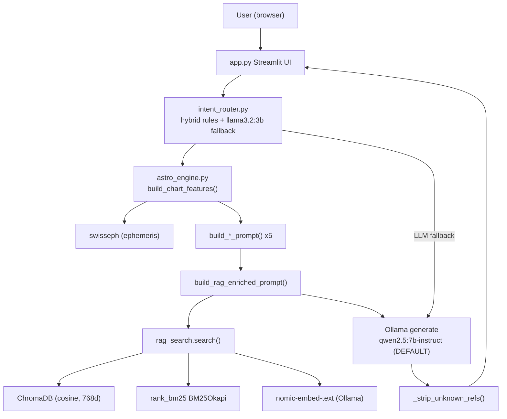
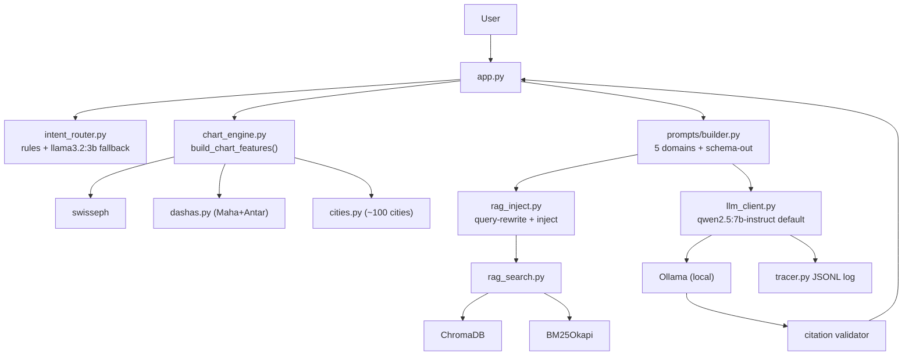
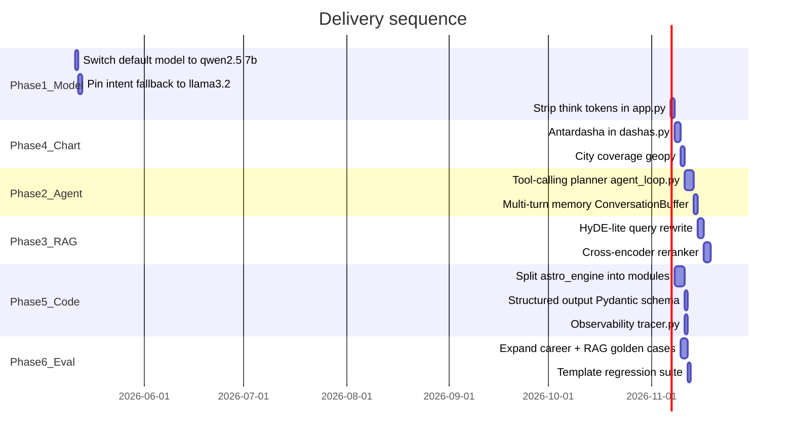

# AGENT_PROD_PLAN.md — Vedic Astrology Agent: Production Upgrade Plan

> **For agents picking this up in a new session:** read this file first.
> Update the `## Progress tracker` section below as tasks complete.
> All file paths are relative to the repo root.

---

## Situation summary

The current stack (as of 2026-05-10) is a well-built *pipeline* with excellent retrieval foundations
(ChromaDB + BM25 + heuristic rerank, 25-case golden eval at 1.00/1.00/+0.50) but has several
correctness, reliability, and scalability gaps before it is "production" quality.

---

## Current architecture

**Core problems in the current flow:**
- `deepseek-r1:14b` is a *reasoning* model; it generates `<think>` blocks, burns VRAM, and holds templates worse than a smaller *instruct* model
- Intent router's LLM fallback calls the same 14B model (30s+ for a 1-token JSON answer)
- No multi-turn memory — chat history collected in `app.py` but never injected into prompts
- No structured-output enforcement — template adherence is best-effort string matching
- No Antardasha (sub-dasha) — only Mahadasha is computed and surfaced
- Only 5 cities hardcoded in `utils.py`; any other city silently falls back to Bengaluru, producing wrong charts
- Single 757-line `astro_engine.py` mixes config, compute, prompting, HTTP, and RAG
- No tracing or per-stage latency logging

---

## Proposed architecture

---

## Progress tracker

Update status here as tasks complete. Format: `[ ]` pending → `[x]` done → `[~]` in progress.

### Phase 1 — Model & inference (do first, highest ROI)

- [x] **p1a** Switch `MODEL_NAME` default to `qwen2.5:7b-instruct` in `astro_engine.py` line 18; add `DEEP_MODEL_NAME = "deepseek-r1:14b"` opt-in via `--deep` flag / `ASTRO_DEEP_MODEL` env var
- [x] **p1b** Hard-pin intent fallback model: introduce `INTENT_CLASSIFIER_MODEL = "llama3.2:3b"` in `intent_router.py`; never fall back to the main generation model for a 1-token JSON answer
- [x] **p1c** Add `text_utils.py` with `strip_reasoning_blocks(text)` (re-use regex from `eval_grounding.py`); wire into `app.py` streaming display so `<think>` blocks are not shown to users

**Verification after Phase 1:** run `python evaluate_career.py --rag --retention-mode rag --judge-model llama3.2:3b` and confirm `rag_judge_grounding_avg` does not regress vs the last accepted record in `eval_history.json`.

**Phase 1 verification record (2026-05-10):** Command: `python evaluate_career.py --rag --retention-mode rag --judge-model llama3.2:3b`. Generation model `qwen2.5:7b-instruct`, judge `llama3.2:3b`, `num_ctx=16384`, `timeout_s=120`. Retention decision baseline record `career_20260502_114813` had `rag_judge_grounding_avg=4`. This run **passed** (`Decision: accepted: RAG guardrails passed`); summary metrics: `rag_judge_grounding_avg=4.5` (no regression), `rag_judge_supported_ratio_avg=0.9`, `rag_grounding_max_sim_avg=0.652`, `rag_grounding_mean_sim_avg=0.6041`, `rag_enriched_template_avg=1.0`, `rag_enriched_citation_avg=2.25`. Accepted record saved as `eval_records/career_20260510_122641.json` (local; `eval_records/` is gitignored).

### Phase 2 — Agentic loop

- [x] **p2a** Create `agent_loop.py`: `TOOLS` dict (`build_chart`, `rag_search`, `get_dasha`, `detect_intent`); use Ollama native `tools` format (supported since Ollama 0.3); ReAct loop with 2-turn fallback to current linear path
- [x] **p2b** Multi-turn memory: add `ConversationBuffer` (rolling last N=3 turns, ~300 token cap) in `app.py`; inject as `PriorContext:` block before `Question:` in `_build_domain_prompt`; summarise overflow with a one-shot `llama3.2:3b` call

**Phase 2 implementation notes (2026-05-10):** New files: `agent_loop.py` (ReAct loop, MAX_AGENT_TURNS=2, /api/chat tools endpoint, 4 tools, linear fallback via `query_ollama_once`), `conversation.py` (`ConversationBuffer` class + `make_summarize_fn` factory). Modified: `astro_engine.py` — `prior_context` param threaded through `_build_domain_prompt` → all 5 domain builders → `build_prompt_for_intent` → `build_rag_enriched_prompt`. Modified: `app.py` — `ConversationBuffer` initialised in session state; `prior_context` extracted before each query; agent-loop path added (non-streaming, behind "Enable Agent Loop" checkbox); buffer updated after each completed turn. RAG path and linear path both inject `PriorContext:` block when history is present.

### Phase 2 — Streamlit UI (follow-ups & layout) — done

- [x] **p2ui-a** Follow-up questions: removed the `return` that ran when `pending_request` was empty (which hid the whole page on the next rerun). Conversation, structured reading, and chart expanders render on every load; birth defaults persist in `saved_birth` after each successful run so the user can change only the question and resubmit.
- [x] **p2ui-b** Agent settings moved to the **sidebar** (RAG, agent loop, model override, timeout) with a **Reset conversation** control; main area keeps birth details + question form only.
- [x] **p2ui-c** Structured reading: new `response_sections.py` (`parse_structured_answer`) drives tabs (**Summary**, **Evidence**, **Risk & opportunity**, **Confidence**) plus **Raw model output** expander; chat assistant bubbles show a pointer to structured content (older turns show a snippet expander instead of the full wall of text).
- [x] **p2ui-d** Customer-friendly copy: strip `[ref:…]` tags for default UI (`text_utils.format_consumer_text`); relabel tabs (Overview, Key points, Cautions & upside); confidence as plain-language + progress bar; raw output only when sidebar **Show technical details** is on; optional “How this answer was grounded” expander without exposing verse IDs.
- [x] **p2ui-e** Chat UX: use `st.chat_input` for follow-ups so the UI feels like real chat (user bubble appears immediately).

**Phase 2 UI notes (2026-05-11):** Linear generation still streams into a transient placeholder; successful runs append `assistant` to `chat_history` only on success (no orphan messages on Ollama errors). `last_features` / `last_retrieved_rows` / `last_prompt_preview` stay in session for Sources and prompt preview between turns. **p2ui-d (2026-05-11):** Default view hides `[ref:…]` ids and raw template noise; practitioner/raw view is opt-in via sidebar. **p2ui-e (2026-05-12):** `st.chat_input` follow-ups with immediate user message bubble.

### Phase 3 — RAG quality

- [x] **p3a** HyDE-lite query rewrite: in `rag_search.py` `expand_queries()`, optionally add an `llama3.2:3b` rewrite query gated by `cfg.QUERY_REWRITE_ENABLED` (default `False` in `rag_config.py`); constrained post-processing keeps retrieval stable. **Verification record below.**

**Phase 3a verification (2026-05-12):** Golden set `data/golden/rag_eval_v0.json` (25 cases), `python3 evaluate_rag.py --db-path chroma_db --no-retention` (no `--judge-model`; production-style `intent_router.detect_intent`). `intent_num_ctx=16384`, `intent_routing_agreement=0.92` on all runs below.

| Run | HyDE (`QUERY_REWRITE_ENABLED`) | `rag_recall_at_3_gold` | `rag_recall_at_5_silver` | `rag_heuristic_delta` | `outcomes_checksum` (first 16 hex) |
|-----|--------------------------------|------------------------|---------------------------|-------------------------|--------------------------------------|
| Baseline | `False` (default) | 0.96 | 0.92 | 0.522 | `8f7073ff4189de95…` |
| HyDE v1 (looser prompt) | `True` (runtime) | 0.88 | 0.80 | 0.261 | `629b35cc587ed916…` (regressed; prompt tightened) |
| HyDE v2 (constrained rewrite) | `True` (runtime) | 0.96 | 0.88 | 0.522 | `74ef2f7fb2870be7…` |

**Takeaway:** v2 preserves gold@3 and heuristic delta vs baseline; silver@5 is slightly lower (0.92 → 0.88). HyDE remains **opt-in** until product wants the tradeoff (extra `llama3.2:3b` call per retrieval). Local report JSONs: `rag_eval_report_phase3a_off_v2.json`, `rag_eval_report_phase3a_on.json`, `rag_eval_report_phase3a_on_v2.json` (gitignored / not committed).

- [ ] **p3b** Cross-encoder reranker: replace heuristic `_rerank()` (`rag_search.py` lines 531-588) with `bge-reranker-v2-m3` or `ms-marco-MiniLM-L-6-v2` (~400MB, CPU-only) via `sentence-transformers`; keep heuristic as fallback. **Prerequisite: p1a must be done first to free VRAM.**
- [ ] **p3c** Antardasha entity in RAG: after p4a, pass the active Antardasha planet into `_query_entities()` (`rag_search.py` line 257) so retrieval biases toward sub-lord house effects

### Phase 4 — Chart compute completeness

- [ ] **p4a** Antardasha: add `calculate_antardashas(mahadasha_lord, maha_start, maha_end)` to `dashas.py` using standard Vimshottari proportional sub-period formula; surface as `ActiveAntardasha:` in `_render_dasha_section()` (`astro_engine.py` lines 207-213) and in the Streamlit "Dasha Snapshot" expander
- [ ] **p4b** City coverage: add `geopy`-based geocoder fallback in `utils.py` (Nominatim, LRU cache via `functools.lru_cache`); raise explicit error instead of silently defaulting to Bengaluru
- [ ] **p4c** (nice-to-have) Bhava chalit: store cusp-based `bhava_positions` (planet → actual house) in `build_chart_features()` return value; cusps are already computed at `astro_engine.py` line 58 but unused

### Phase 5 — Code structure & reliability

- [ ] **p5a** Split `astro_engine.py` (757 lines) into:
  - `chart_engine.py` — ephemeris compute (`build_chart_features`, `generate_full_chart`, `generate_chart_facts`)
  - `prompts/builder.py` — `build_*_prompt` x5 + `build_prompt_for_intent`
  - `rag_inject.py` — `build_rag_enriched_prompt`, `append_classical_references_block`, `_render_rag_block`, `_strip_unknown_refs`
  - `llm_client.py` — `_call_ollama`, `run_astro_query`, `query_ollama_once`, `resolve_ollama_config`
  - `astro_engine.py` → thin re-export shim for backward compatibility
- [ ] **p5b** Structured output: add Ollama `format=` JSON schema to `_call_ollama()` when caller passes a `response_schema`; define `DomainResponseSchema` (Pydantic) in `prompts/schema.py` with fields `summary`, `evidence` (list), `risk`, `opportunity`, `confidence` (int)
- [ ] **p5c** Observability: create `tracer.py` — JSONL append one record per LLM call (`{timestamp, model, intent, prompt_tokens_est, latency_ms, rag_active, ref_count, hallucinated_refs, template_score}`); add `scripts/trace_summary.py`
- [ ] **p5d** Fix `requirements.txt`: add `numpy>=1.26,<3`, `sentence-transformers>=2.7`, `geopy>=2.4`

### Phase 6 — Evaluation improvements

- [ ] **p6a** Expand `evaluate_career.py` `DEFAULT_CASES`: add at least 2 cases per non-career domain (health, wealth, family); add antardasha-aware cases (Saturn MD / Moon AD career outlook)
- [ ] **p6b** Expand `data/golden/rag_eval_v0.json` with sub-dasha-aware retrieval cases
- [ ] **p6c** Create `evaluate_template.py`: run each domain prompt builder against fixed chart inputs; assert template adherence ≥ 0.90 per domain; `--fail-on-regression` exit code for CI

---

## Delivery sequence

**Rule:** do not start Phase 3.2 (cross-encoder) before Phase 1.1 (model switch) is verified — the 14B model leaves insufficient VRAM for the reranker on M1 Pro 16GB.

---

## Key files changed per phase

| Phase | Files touched |
|---|---|
| 1 | `astro_engine.py`, `intent_router.py`, `app.py`, new `text_utils.py` |
| 2 | new `agent_loop.py`, `conversation.py`, `response_sections.py`, `app.py`, `astro_engine.py` |
| 3 | `rag_search.py`, `rag_config.py`, `requirements.txt` |
| 4 | `dashas.py`, `utils.py`, `astro_engine.py` |
| 5 | new `chart_engine.py`, `prompts/builder.py`, `rag_inject.py`, `llm_client.py`, `tracer.py`, `scripts/trace_summary.py`, `requirements.txt` |
| 6 | `data/golden/rag_eval_v0.json`, `evaluate_career.py`, new `evaluate_template.py` |

---

## Notes for future agents

- Always run `evaluate_rag.py` after touching `rag_search.py` or `rag_config.py`. The golden eval is at `data/golden/rag_eval_v0.json` (25 cases). Current accepted baseline: `1.00 / 1.00 / +0.50`.
- `rag_eval_history.json`, `eval_history.json`, and the `*_eval_records/` directories are gitignored — regenerate locally.
- The BPHS corpus `.txt` files under `data/corpus/` are gitignored. Reproduce from `Brihat Parasara Hora Sastra with English Translation Girish Chand Sharma Volume 1.pdf` using `tools/extract_bphs_vol1_from_map.py` + `scripts/ingest_bphs_from_full_pdf_dir.py`.
- Context window default is 16384 (`astro_engine.py` line 20). With RAG refs injected, prompts are typically 2000-4000 tokens. Do not raise `num_ctx` above 16384 on M1 Pro 16GB with a 7B model without measuring swap.
- See `RAG_PLAN.md` for the detailed retrieval decisions log (do not re-litigate without strong reason).
