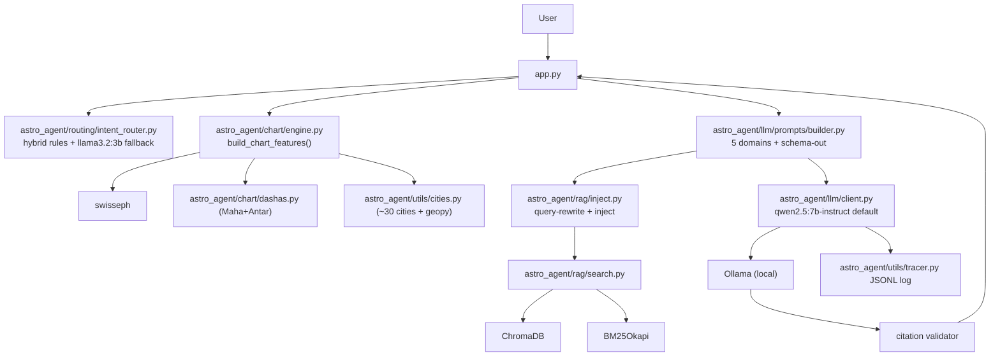
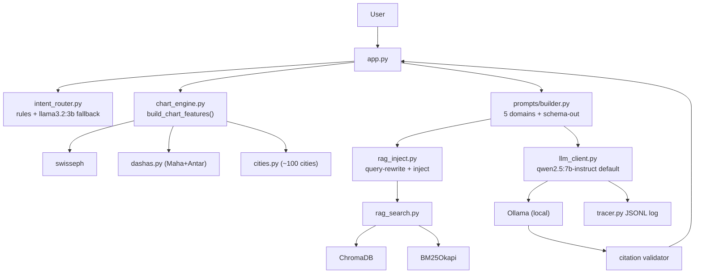
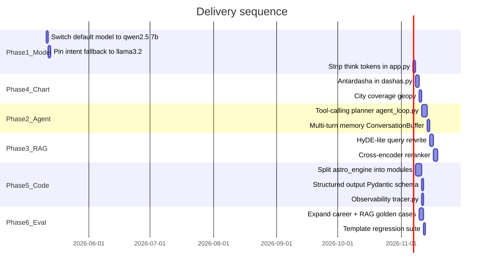

# AGENT_PROD_PLAN.md — Vedic Astrology Agent: Production Upgrade Plan

> **For agents picking this up in a new session:** read this file first.
> Update the `## Progress tracker` section below as tasks complete.
> All file paths are relative to the repo root.

---

## Situation summary

The current stack (as of 2026-05-30) is a well-built *pipeline* with excellent retrieval foundations
(ChromaDB + BM25 + heuristic rerank, 25-case golden eval at 1.00/1.00/+0.50). All six original
phases are complete. The remaining work is code structure (Phase 7 restructure, now done) and
ongoing corpus / eval expansion.

---

## Current architecture (as of Phase 7 restructure)

All previously identified gaps have been resolved. See Progress tracker below.

---

## Proposed architecture

---

## Progress tracker

Update status here as tasks complete. Format: `[ ]` pending → `[x]` done → `[~]` in progress.

### Phase 1 — Model & inference (do first, highest ROI)

- [x] **p1a** Switch `MODEL_NAME` default to `qwen2.5:7b-instruct` in `astro_engine.py` line 18; add `DEEP_MODEL_NAME = "deepseek-r1:14b"` opt-in via `--deep` flag / `ASTRO_DEEP_MODEL` env var
- [x] **p1b** Hard-pin intent fallback model: introduce `INTENT_CLASSIFIER_MODEL = "llama3.2:3b"` in `intent_router.py`; never fall back to the main generation model for a 1-token JSON answer
- [x] **p1c** Add `text_utils.py` with `strip_reasoning_blocks(text)` (re-use regex from `eval_grounding.py`); wire into `app.py` streaming display so `<think>` blocks are not shown to users

**Verification after Phase 1:** run `python evaluate_career.py --rag --retention-mode rag --judge-model llama3.2:3b` and confirm `rag_judge_grounding_avg` does not regress vs the last accepted record in `eval_history.json`.

**Phase 1 verification record (2026-05-10):** Command: `python evaluate_career.py --rag --retention-mode rag --judge-model llama3.2:3b`. Generation model `qwen2.5:7b-instruct`, judge `llama3.2:3b`, `num_ctx=16384`, `timeout_s=120`. Retention decision baseline record `career_20260502_114813` had `rag_judge_grounding_avg=4`. This run **passed** (`Decision: accepted: RAG guardrails passed`); summary metrics: `rag_judge_grounding_avg=4.5` (no regression), `rag_judge_supported_ratio_avg=0.9`, `rag_grounding_max_sim_avg=0.652`, `rag_grounding_mean_sim_avg=0.6041`, `rag_enriched_template_avg=1.0`, `rag_enriched_citation_avg=2.25`. Accepted record saved as `eval_records/career_20260510_122641.json` (local; `eval_records/` is gitignored).

### Phase 2 — Agentic loop

- [x] **p2a** Create `agent_loop.py`: `TOOLS` dict (`build_chart`, `rag_search`, `get_dasha`, `detect_intent`); use Ollama native `tools` format (supported since Ollama 0.3); ReAct loop with 2-turn fallback to current linear path
- [x] **p2b** Multi-turn memory: add `ConversationBuffer` (rolling last N=3 turns, ~300 token cap) in `app.py`; inject as `PriorContext:` block before `Question:` in `_build_domain_prompt`; summarise overflow with a one-shot `llama3.2:3b` call

**Phase 2 implementation notes (2026-05-10):** New files: `agent_loop.py` (ReAct loop, MAX_AGENT_TURNS=2, /api/chat tools endpoint, 4 tools, linear fallback via `query_ollama_once`), `conversation.py` (`ConversationBuffer` class + `make_summarize_fn` factory). Modified: `astro_engine.py` — `prior_context` param threaded through `_build_domain_prompt` → all 5 domain builders → `build_prompt_for_intent` → `build_rag_enriched_prompt`. Modified: `app.py` — `ConversationBuffer` initialised in session state; `prior_context` extracted before each query; agent-loop path added (non-streaming, behind "Enable Agent Loop" checkbox); buffer updated after each completed turn. RAG path and linear path both inject `PriorContext:` block when history is present.

### Phase 2 — Streamlit UI (follow-ups & layout) — done

- [x] **p2ui-a** Follow-up questions: removed the `return` that ran when `pending_request` was empty (which hid the whole page on the next rerun). Conversation, structured reading, and chart expanders render on every load; birth defaults persist in `saved_birth` after each successful run so the user can change only the question and resubmit.
- [x] **p2ui-b** Agent settings moved to the **sidebar** (RAG, agent loop, model override, timeout) with a **Reset conversation** control; main area keeps birth details + question form only.
- [x] **p2ui-c** Structured reading: new `response_sections.py` (`parse_structured_answer`) drives tabs (**Summary**, **Evidence**, **Risk & opportunity**, **Confidence**) plus **Raw model output** expander; chat assistant bubbles show a pointer to structured content (older turns show a snippet expander instead of the full wall of text).
- [x] **p2ui-d** Customer-friendly copy: strip `[ref:…]` tags for default UI (`text_utils.format_consumer_text`); relabel tabs (Overview, Key points, Cautions & upside); confidence as plain-language + progress bar; raw output only when sidebar **Show technical details** is on; optional “How this answer was grounded” expander without exposing verse IDs.
- [x] **p2ui-e** Chat UX: use `st.chat_input` for follow-ups so the UI feels like real chat (user bubble appears immediately).

**Phase 2 UI notes (2026-05-11):** Linear generation still streams into a transient placeholder; successful runs append `assistant` to `chat_history` only on success (no orphan messages on Ollama errors). `last_features` / `last_retrieved_rows` / `last_prompt_preview` stay in session for Sources and prompt preview between turns. **p2ui-d (2026-05-11):** Default view hides `[ref:…]` ids and raw template noise; practitioner/raw view is opt-in via sidebar. **p2ui-e (2026-05-12):** `st.chat_input` follow-ups with immediate user message bubble.

### Phase 3 — RAG quality

- [x] **p3a** HyDE-lite query rewrite: in `rag_search.py` `expand_queries()`, optionally add an `llama3.2:3b` rewrite query gated by `cfg.QUERY_REWRITE_ENABLED` (default `False` in `rag_config.py`); constrained post-processing keeps retrieval stable. **Verification record below.**

**Phase 3a verification (2026-05-12):** Golden set `data/golden/rag_eval_v0.json` (25 cases), `python3 evaluate_rag.py --db-path chroma_db --no-retention` (no `--judge-model`; production-style `intent_router.detect_intent`). `intent_num_ctx=16384`, `intent_routing_agreement=0.92` on all runs below.

| Run | HyDE (`QUERY_REWRITE_ENABLED`) | `rag_recall_at_3_gold` | `rag_recall_at_5_silver` | `rag_heuristic_delta` | `outcomes_checksum` (first 16 hex) |
|-----|--------------------------------|------------------------|---------------------------|-------------------------|--------------------------------------|
| Baseline | `False` (default) | 0.96 | 0.92 | 0.522 | `8f7073ff4189de95…` |
| HyDE v1 (looser prompt) | `True` (runtime) | 0.88 | 0.80 | 0.261 | `629b35cc587ed916…` (regressed; prompt tightened) |
| HyDE v2 (constrained rewrite) | `True` (runtime) | 0.96 | 0.88 | 0.522 | `74ef2f7fb2870be7…` |

**Takeaway:** v2 preserves gold@3 and heuristic delta vs baseline; silver@5 is slightly lower (0.92 → 0.88). HyDE remains **opt-in** until product wants the tradeoff (extra `llama3.2:3b` call per retrieval). Local report JSONs: `rag_eval_report_phase3a_off_v2.json`, `rag_eval_report_phase3a_on.json`, `rag_eval_report_phase3a_on_v2.json` (gitignored / not committed).

- [x] **p3b** Cross-encoder reranker: optional `sentence_transformers.CrossEncoder` (`cross-encoder/ms-marco-MiniLM-L-6-v2` by default, `BAAI/bge-reranker-v2-m3` via env) in `rag_search.py`; scores are **blended** with min-max normalized heuristic scores (`CROSS_ENCODER_HEURISTIC_BLEND`, default `0.15`) because pure CE regressed gold@3 on the golden set; heuristic-only if CE is disabled, load fails, or question is empty. Config: `rag_config.py` (`CROSS_ENCODER_*`, env `ASTRO_CROSS_ENCODER_*`). CLI: `evaluate_rag.py --cross-encoder`. **Verification record below.**

**Phase 3b verification (2026-05-12):** Golden set `data/golden/rag_eval_v0.json` (25 cases), `python3 evaluate_rag.py --db-path chroma_db --no-retention`, `intent_num_ctx=16384`, `intent_routing_agreement=0.92`.

| Run | Cross-encoder | Blend (CE weight) | `rag_recall_at_3_gold` | `rag_recall_at_5_silver` | `rag_heuristic_delta` | `outcomes_checksum` (first 16 hex) |
|-----|---------------|-------------------|------------------------|---------------------------|-------------------------|--------------------------------------|
| Baseline | off | — | 0.96 | 0.92 | 0.522 | `8f7073ff4189de95…` |
| CE pure | on (`--cross-encoder`), blend 1.0 | 1.0 | 0.92 | 0.56 | 0.043 | `9be10d58e94a85f1…` (regressed) |
| CE + heuristic (default) | on, default blend 0.15 | 0.15 | 0.96 | 0.92 | 0.609 | `c46d997809df3663…` |

**Takeaway:** Cross-encoder stays **opt-in** (`CROSS_ENCODER_RERANK_ENABLED` / `--cross-encoder`); default blend preserves gold/silver parity vs baseline and improves mean heuristic delta; tune `ASTRO_CROSS_ENCODER_HEURISTIC_BLEND` if you switch reranker model.
- [x] **p3c** Antardasha entity in RAG: after p4a, pass the active Antardasha planet into `_query_entities()` (`rag_search.py`, near `_query_entities`) so retrieval biases toward sub-lord house effects

**Phase 3c verification (2026-05-14):** `_features_to_chart_facts` sets `chart_facts["_antardasha_lord"]` from `active_antardasha["dasha"]`; `_summarize_chart_facts` appends `{Lord} antardasha Vimshottari` for dense/BM25 + entity rerank. Golden `python3 evaluate_rag.py --db-path chroma_db --no-retention` unchanged vs baseline: `rag_recall_at_3_gold=0.96`, `rag_recall_at_5_silver=0.92`, `rag_heuristic_delta=0.522`, `outcomes_checksum=8f7073ff4189de95…` (full hash matches prior record). Tests: `tests/test_rag_antardasha_entity.py`.

### Phase 4 — Chart compute completeness

- [x] **p4a** Antardasha: add `calculate_antardashas(mahadasha_lord, maha_start, maha_end)` to `dashas.py` using standard Vimshottari proportional sub-period formula; surface as `ActiveAntardasha:` in `_render_dasha_section()` (`astro_engine.py` lines 207-213) and in the Streamlit "Dasha Snapshot" expander

**Phase 4a verification (2026-05-14)**

**Automated:** `python3 -m pytest tests/test_dashas_antar.py -q` → **12 passed** (9 parametrized order/count cases + 3 named tests).

| Test | What it asserts |
|------|-----------------|
| `test_antardasha_order_and_count` (×9 MD lords) | First antar = MD lord; sequence follows `DASHA_SEQUENCE`; exactly 9 segments |
| `test_antardasha_contiguity_mass_balance_and_nesting` | `start` ≤ `end`; each segment inside MD bounds; consecutive starts within 1 day of prior end; sum of antar days ≈ MD span (≤ 2 day tolerance) |
| `test_get_current_and_next_antardasha_finds_window` | Active segment contains query date; next segment starts after active end |
| `test_invalid_inputs_return_empty` | Unknown lord or inverted dates → `[]` |

**Smoke (integration, one chart):** `build_chart_features(1990, 5, 15, 10, 30, "bengaluru")` on 2026-05-14 — active Mahadasha Rahu `2011-12-08`–`2029-12-07`; active Antardasha Venus `2023-06-24`–`2026-06-23` (nested in MD); `len(antardasha_timeline_current_md) == 9`; `date.today()` inside active antar window.

**Manual (not automated in CI):** Streamlit “Dasha snapshot” and run-summary metrics show MD + antar labels; agent `get_dasha` tool returns the same four lines as `features` (see `agent_loop._tool_get_dasha`); domain prompts include `- Active Antardasha:` / `- Next Antardasha:` via `_render_dasha_section`.

**Omitted:** `evaluate_rag.py` — no `rag_search.py` change in p4a; rerun after **p3c** when antar is fed into `_query_entities`.

**Artifacts:** `dashas.py` (`calculate_antardashas`, `get_current_and_next_antardasha`), `astro_engine.py`, `app.py`, `agent_loop.py`, `tests/test_dashas_antar.py`, `requirements.txt` (`pytest`).
- [x] **p4b** City coverage: `cities.py` with geopy Nominatim + LRU cache; `CityResolutionError` (no silent Bengaluru fallback); Streamlit free-text city input

**Phase 4b verification (2026-05-17):** `python3 -m pytest tests/test_cities.py -q` → 6 passed. Static cities unchanged; unknown cities raise.

- [x] **p4c** Bhava chalit: `sign_houses`, `bhava_positions`, `house_cusps` in `build_chart_features()`; `USE_BHAVA_FOR_RAG` env (`ASTRO_USE_BHAVA_FOR_RAG`)

**Phase 4c verification (2026-05-17):** `python3 -m pytest tests/test_bhava_positions.py tests/test_dashas_antar.py -q` → 15 passed.

### Phase 5 — Code structure & reliability

- [x] **p5a** Split into `chart_engine.py`, `prompts/builder.py`, `rag_inject.py`, `llm_client.py`; `astro_engine.py` re-export shim; `tests/test_import_shim.py`
- [x] **p5b** `prompts/schema.py` (`DomainResponseSchema`); `STRUCTURED_OUTPUT_ENABLED` / `ASTRO_STRUCTURED_OUTPUT`; Ollama `format=` in `llm_client._call_ollama`; JSON path in `response_sections.py`
- [x] **p5c** `tracer.py` + `scripts/trace_summary.py`; hooks in `llm_client.query_ollama_once` and `agent_loop._call_ollama_chat` (`ASTRO_TRACE_ENABLED`)
- [x] **p5d** `requirements.txt`: added `geopy>=2.4,<3`, `pydantic>=2.0,<3` (numpy/ST already present)

### Phase 6 — Evaluation improvements

- [x] **p6a** `evaluate_career.py`: 9 cases (2 per non-career domain + `career_saturn_md_moon_ad`); domain-aware `score_template_adherence` via `eval_template_markers.py`
- [x] **p6b** `data/golden/rag_eval_v0.json`: +5 antardasha cases; `chart_context_to_minimal_features` passes `_antardasha_lord`
- [x] **p6c** `evaluate_template.py` + `scripts/run_ci_checks.sh` (pytest + template `--fail-on-regression`)

### Phase 7 — Code restructure & tooling (2026-05-30)

- [x] **p7a** Moved `RAG_PLAN.md`, `AGENT_PROD_PLAN.md`, `FUTURE_IMPROVEMENTS.md` → `docs/`
- [x] **p7b** Moved all `evaluate_*.py`, `eval_*.py`, `run_pr1_acceptance_watch.py` → `evals/` package
- [x] **p7c** Created `astro_agent/` package with domain subdirectories: `chart/`, `llm/`, `rag/`, `routing/`, `agent/`, `utils/`
- [x] **p7d** Migrated all module code into `astro_agent/`; root files are now backward-compat shims
- [x] **p7e** Updated `app.py`, tests, evals to use canonical `astro_agent.*` imports
- [x] **p7f** Added `data/__init__.py` + `data/golden/__init__.py` for clean package imports
- [x] **p7g** Added `pyproject.toml` with `ruff` (lint) and `mypy` (type-check) config
- [x] **p7h** Added `.github/workflows/ci.yml` for automated pytest + ruff on push/PR
- [x] **p7i** Added `requirements-dev.txt` for OCR/ingest tools deps
- [x] **p7j** Added `CHANGELOG.md` to track milestones

**Phase 6 verification (2026-05-17):** `python3 -m pytest tests/ -q` → 30 passed; `python3 evaluate_template.py --fail-on-regression` → all 5 domains ok. Golden RAG re-run requires local Ollama + `chroma_db` (`python3 evaluate_rag.py --db-path chroma_db --no-retention`).

---

## Delivery sequence

**Rule:** do not start Phase 3.2 (cross-encoder) before Phase 1.1 (model switch) is verified — the 14B model leaves insufficient VRAM for the reranker on M1 Pro 16GB.

---

## Key files changed per phase

| Phase | Files touched |
|---|---|
| 1 | `astro_engine.py`, `intent_router.py`, `app.py`, new `text_utils.py` |
| 2 | new `agent_loop.py`, `conversation.py`, `response_sections.py`, `app.py`, `astro_engine.py` |
| 3 | `rag_search.py`, `rag_config.py`, `requirements.txt`, `evaluate_rag.py` |
| 4 | `dashas.py`, `utils.py`, `astro_engine.py`, `app.py`, `agent_loop.py`, `tests/test_dashas_antar.py` |
| 5 | new `chart_engine.py`, `prompts/builder.py`, `rag_inject.py`, `llm_client.py`, `tracer.py`, `scripts/trace_summary.py`, `requirements.txt` |
| 6 | `data/golden/rag_eval_v0.json`, `evaluate_career.py`, new `evaluate_template.py` |

---

## Notes for future agents

- Always run `evaluate_rag.py` after touching `rag_search.py` or `rag_config.py`. The golden eval is at `data/golden/rag_eval_v0.json` (25 cases). Current accepted baseline: `1.00 / 1.00 / +0.50`.
- `rag_eval_history.json`, `eval_history.json`, and the `*_eval_records/` directories are gitignored — regenerate locally.
- The BPHS corpus `.txt` files under `data/corpus/` are gitignored. Reproduce from `books/Brihat Parasara Hora Sastra with English Translation Girish Chand Sharma Volume 1.pdf` using `tools/extract_bphs_vol1_from_map.py` + `scripts/ingest_bphs_from_full_pdf_dir.py`.
- Context window default is 16384 (`astro_engine.py` line 20). With RAG refs injected, prompts are typically 2000-4000 tokens. Do not raise `num_ctx` above 16384 on M1 Pro 16GB with a 7B model without measuring swap.
- See `RAG_PLAN.md` for the detailed retrieval decisions log (do not re-litigate without strong reason).
